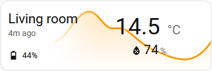
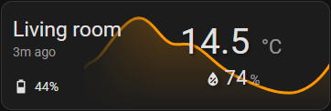

# NC Temperature card

The card shows a small graph of your temperature sensor's history on your Home Assistant dashboard. The current temperature appears on the graph, so you can quickly see whether it is going up or down. You can also show humidity, battery level, and how long ago Home Assistant last saw a change from the sensor.

The card uses standard Home Assistant entities and has a visual editor for setup.

## Screenshots

&nbsp;

## Features

- Current temperature with a history graph for a configurable period of up to seven days.
- Optional min/max markers showing the highest and lowest values on the graph, so the size of the fluctuation is visible even though the axis adapts to the data.
- Optional humidity and battery readings.
- A configurable indicator showing how recently Home Assistant received an update from selected sensor entities.
- Tap the temperature, humidity, or battery reading to open its Home Assistant details.

The graph uses Home Assistant's recorded statistics when available, then falls back to entity history. It can only show data Home Assistant has retained; if neither history source has data, the graph has no points to display.

## Supported Languages

- English
- Hungarian

The card follows your Home Assistant language when a translation is available, and falls back to English otherwise.

## Installation

### HACS

1. Once this repository is available in your HACS catalog, open **Dashboard**, find **NC Temperature**, and install it. For a custom repository, add it to HACS first and select **Dashboard** as its category.
2. HACS registers the dashboard resource automatically. Refresh the browser, then add **NC Temperature** to a dashboard.

### Manual installation

1. Download `nc-temperature-card.js` from the repository's **Releases** page (the asset attached to the latest release). This is the same bundle HACS installs.
2. Create the `/config/www/nc-temperature-card/` directory in your Home Assistant configuration directory.
3. Copy the downloaded `nc-temperature-card.js` into that directory.
4. Add a dashboard resource at **Settings > Dashboards > Resources**:

   - URL: `/local/nc-temperature-card/nc-temperature-card.js`
   - Resource type: **JavaScript module**

5. Refresh the browser, then add **NC Temperature** to a dashboard.

For updates, download the new `nc-temperature-card.js` from the latest release, replace the file, and refresh the browser. If the previous version remains cached, hard-refresh the browser. Dashboard resource registration is managed in Home Assistant and is not automatic.

## Set Up The Card

In the visual editor, select a temperature entity. You can also set a display name, select humidity and battery entities, and adjust the graph and last-updated settings. The temperature entity is required; the other entities are optional.

The same settings can be used in YAML:

```yaml
type: custom:nc-temperature-card
name: Living room
temperature: sensor.living_room_temperature
humidity: sensor.living_room_humidity
battery: sensor.living_room_battery
hours_to_show: 24
graph_color: orange
show_min_max: true
last_seen_mode: configured
last_seen_entities:
  - sensor.living_room_illuminance
last_seen_alert_minutes: 180
```

## Options

| Option | Required | Default | Description |
| --- | --- | --- | --- |
| `temperature` | Yes | None | Temperature entity to display. |
| `name` | No | Friendly name, then entity ID | Display name. |
| `humidity` | No | Not set | Humidity entity. The reading is hidden when unset. |
| `battery` | No | Not set | Battery entity. The reading is hidden when unset. |
| `hours_to_show` | No | `24` | Graph period in hours, greater than 0 and up to 168. The visual editor selects whole hours from 1 to 168. |
| `graph_color` | No | `orange` | Graph color selected from Home Assistant's built-in color presets. |
| `show_min_max` | No | `true` | Shows the maximum and minimum values of the displayed graph with small markers and labels. |
| `last_seen_mode` | No | `configured` | Chooses which entities are monitored for their latest Home Assistant update. See [Last-Updated Indicator](#last-updated-indicator). |
| `last_seen_entities` | No | None | Extra entities monitored when `last_seen_mode` is `configured`. Select these in the visual editor's multi-entity picker. |
| `last_seen_alert_minutes` | No | `180` | Age in whole minutes after which the last-updated indicator turns red. An unavailable temperature or a fully unavailable monitored set also triggers an alert. |

## Last-Updated Indicator

The indicator shows how long ago Home Assistant last exposed an update for the monitored entities. Choose what it monitors with `last_seen_mode`:

- `configured` (default) monitors the temperature entity, any configured humidity and battery entities, and additional entities selected in `last_seen_entities`. The age is based on the most recently updated monitored entity.
- `temperature` monitors only the temperature entity.
- `off` hides the indicator.

Entities on the same physical device are not discovered automatically; add them explicitly with `last_seen_entities`. The age is based on Home Assistant's `last_updated` timestamp for changed states or attributes. It indicates when Home Assistant last observed a change, not direct radio contact with the device; repeated reports with unchanged values may not advance the timestamp. The age threshold is checked approximately once per minute.

## Development

Development requires Node.js 22 or newer. Install dependencies and run the checks/build from the repository directory:

```sh
npm ci
npm run typecheck
npm run build
```

For local Home Assistant development, set `HA_WWW_DIR` to the host directory mounted as `/config/www`:

```powershell
$env:HA_WWW_DIR = "D:\path\to\config\www"
npm run deploy
```

`npm run watch` deploys on start and after source changes. `npm run dev` also watches and rebuilds, and reloads the Home Assistant page after successful builds. These local development commands use a cache-busting preload loader and the `nc-temperature-card.bundle.js` file; this two-file setup is for development, not the manual installation above. When opening Home Assistant from another device, configure `ESBUILD_HOST` and `ESBUILD_PUBLIC_URL` as described in `scripts/dev.js`.

The HACS artifact is the generated ESM bundle at `dist/nc-temperature-card.js`. Build it with `npm run build`; do not edit the generated bundle directly.
